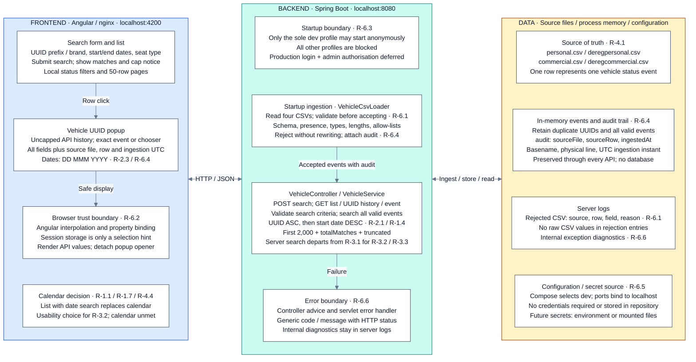

# VRLS2 architecture

Current implementation, arranged as three layers. Cross-column arrows represent requests, responses and data access; the data layer runs within the API process or its files, not a separate database service.

The 2,000-result cap limits complete history access (R-4.5), although UUID detail lookups are uncapped. The two-second target (R-3.3) remains unmeasured. Audit data is held in memory; future persistence must retain it alongside events. Decisions and the production authentication closure plan are recorded in [ADR 0001](adr/0001-vrls2-takehome.md).
